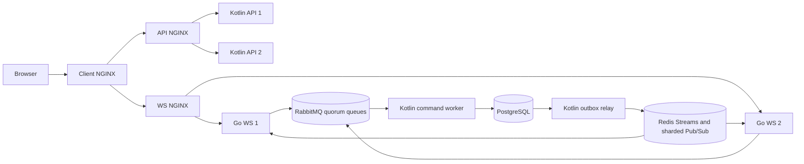

# Messenger prototype

A browser chat with direct and group conversations, durable history, multiple devices per user, and two API and two WebSocket instances. The client follows Feature-Sliced Architecture and runs from one public address.

## Run it

```sh
docker compose up --build -d
```

Open [http://localhost:8080](http://localhost:8080). Create two accounts in separate browser windows, start a direct conversation, and send a message. A group conversation can include several registered users. Docker Compose starts PostgreSQL, RabbitMQ, Redis, two Kotlin HTTP API instances, a Kotlin command worker, a Kotlin outbox relay, two Go socket servers, separate NGINX API and socket proxies, and the React client. Only the client publishes a host port; its NGINX sends `/api/` to the API proxy and `/ws` to the socket proxy.

```sh
docker compose ps
docker compose logs -f api-1 command-worker outbox-relay ws-1
npm run test:system
npm run test:resilience
docker compose down
```

Use `docker compose down -v` only when you intend to remove local chat history and Redis data.

## Message path



The socket server verifies the session and conversation membership through the API. A `queued` frame follows a RabbitMQ publisher confirm. The worker assigns a conversation sequence and saves the message, request result, and outbox rows in one SQL transaction before it acknowledges the command. The relay appends a short Redis Stream entry and publishes each room event. A socket write does not mean a device applied the message; the browser sends an `applied` frame after incorporating it.

The client fetches SQL history on chat open and reconnect. Redis replay uses a room epoch and Stream cursor only when the prior cursor is still retained; otherwise the socket reports `recovery_failed` and the client catches up through the history API. SQL history is the authoritative cursor. Relay retries can duplicate a live event, so the client deduplicates by message ID and orders by decimal-string conversation sequence.

Rabbit commands use the direct exchange `messenger.commands` and four durable quorum queues `messenger.send.0` through `.3`. Go chooses a partition using FNV-1a 32 over the UTF-8 conversation ID modulo four. The API owns queue declarations and a durable dead-letter queue for malformed or exhausted commands. Redis keys for a logical room use a shared cluster hash tag, for example `messenger:{user:01...}:stream`, `:epoch`, and `:live`. A single WS instance maintains one Redis subscription per locally active room.

## Checks and source of contracts

```sh
./api/gradlew -p api test ktlintCheck --no-daemon
go -C ws vet ./...
go -C ws test -race -count=1 ./...
npm --prefix client run typecheck
npm --prefix client test
npm run validate:asyncapi
npm run test:contracts
npm run test:system
npm run test:resilience
```

Kotlin controllers own the HTTP contract. `npm run generate:openapi` exports it to `contracts/openapi.yaml` and generates client declarations. The AsyncAPI files and JSON Schemas under `contracts/` own Rabbit commands, Redis room events, and socket frames. `npm run generate:asyncapi:kotlin` and `npm run generate:asyncapi:go` regenerate their models. Generated files are committed with contract changes.

Contract generation uses Node 24.11 or newer. Install dependencies with `npm ci` at the repository root and `npm --prefix contracts ci` before running generation and fixture scripts.

This is a local prototype. The Compose deployment has one PostgreSQL, RabbitMQ, and Redis instance and uses demo credentials; deploy those dependencies with their own availability and secret management before using it outside a local environment. The short Redis history does not replace SQL catch-up, including after Redis loss.
