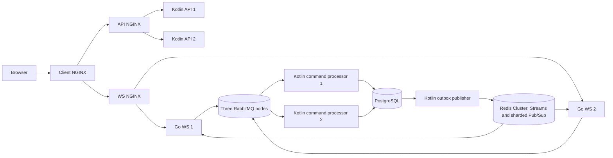

# Messenger prototype

A browser chat with direct and group chats, durable history, multiple devices per user, and two API and two WebSocket instances. The client follows Feature-Sliced Architecture and runs from one public address.

## Run it

```sh
scripts/dev-up.sh
```

Open [http://localhost:8080](http://localhost:8080). Create two accounts in separate browser windows, start a direct chat, and send a message. A group chat can include several registered users. Docker Compose starts PostgreSQL, three RabbitMQ nodes, a six-node Redis Cluster with three primaries and three replicas, two Kotlin HTTP API instances, two Kotlin Messenger command processors, two Kotlin outbox publishers, two Go socket servers, separate NGINX API and socket proxies, and the React client. The client is the only application ingress; its NGINX sends `/api/` to the API proxy and `/ws` to the socket proxy. Local monitoring ports bind to `127.0.0.1`.

The launcher creates a random shared WS ticket signing key in the ignored `.env` file on first run. Keep that file for subsequent starts so both API and WS instances verify the same tickets.

Open [Grafana](http://localhost:3000/d/messenger-overview/messenger-overview) with `admin` / `admin` and [Prometheus targets](http://localhost:9090/targets). See [monitoring](docs/monitoring.md) for dashboards, alerts, metric meanings, and local port overrides.

```sh
docker compose ps
docker compose logs -f api-1 messenger-command-processor messenger-outbox-publisher ws-1
npm run test:system
npm run test:resilience
docker compose down
```

Use `docker compose down -v` only when you intend to remove local chat history, queued commands, and Redis data.

Redis Cluster nodes use fixed addresses on the Compose network so a full local restart retains the same advertised addresses. If `10.245.0.0/24` overlaps another network, set `MESSENGER_SUBNET` and the matching three-octet `MESSENGER_REDIS_IP_PREFIX` before starting the stack.

## Message path



The browser obtains a one-hour signed WS ticket from the API and reuses it across reconnects until near expiry. It sends the ticket in the WebSocket subprotocol header; both NGINX hops disable `/ws` access logging. A WS node verifies its signature locally, joins the personal room, then calls the API's private gRPC service once to check the ticket's SQL session before it reads or writes application frames. Group subscribe and renewal also call gRPC to check current session and SQL membership. Direct chats use the authenticated personal room. Sending does not call the API: the command processor checks membership before saving. A `queued` frame follows a RabbitMQ publisher confirm. The command processor assigns a chat sequence and saves the message, request result, and outbox rows in one SQL transaction before it acknowledges the command. An outbox insert sends a PostgreSQL notification at commit, waking the publisher. The publisher drains bounded batches without a batch-count cap, appends a short Redis Stream entry, and publishes each room event. A one-second fallback scan handles missed notifications and expired leases. A socket write does not mean a device applied the message; the browser sends an `applied` frame after incorporating it.

`POST /api/v1/auth/logout` deletes the current SQL session and enqueues a `session_revoked` event in the same transaction. Matching open sockets close when that event reaches their personal room; reconnects check SQL again. If the event is lost while a socket remains open, its signed ticket expiry closes it within one hour. Group removal uses the same transactional-outbox-to-personal-room pattern; the browser renews its selected group every eight minutes and the WS group lease expires after ten minutes if renewal fails. The system does not promise an immediate cutoff after a missed event.

Each WS connection holds a Redis lease under its user ID. An atomic Redis script admits at most ten active leases per user across WS nodes; sockets renew every 30 seconds and crashed-node leases expire after 90 seconds. A Redis failure rejects new admissions or closes sockets whose leases cannot renew. The WS node defaults to 16 in-flight handshakes (`WS_MAX_PENDING_UPGRADES`), 30 handshake attempts per user per minute (`WS_HANDSHAKE_RATE`, `WS_HANDSHAKE_WINDOW`), 16 concurrent group authorization calls (`WS_MAX_GROUP_AUTHS`), and ten subscription attempts per user per second (`WS_SUBSCRIBE_RATE`, `WS_SUBSCRIBE_WINDOW`). In the Compose deployment, the public NGINX proxy applies per-IP limits to login, registration, WS tickets, and WS upgrades. Configure IP trust and admission rates at the outermost trusted proxy when placing another ingress in front of Compose. Redis asynchronous failover can briefly lose a lease write, so ten is an abuse-control target rather than an absolute invariant during failover.

Each socket tracks at most 256 written message notifications awaiting a response by default. The browser sends an exact `received_message` frame when it handles a live notification, even if an older SQL history gap is still unresolved. This releases socket pressure without advancing the recovery cursor. If a frame gets no response for 30 seconds or the pending window fills, the WS server closes with code 4001; the client reconnects and fetches SQL history. On first opening a chat, the client starts from the newest history page and sends `dismissed` through the unseen prefix; after an existing recovery gap, only an explicit Jump to latest dismisses that prefix. The visible page is applied separately, and older pages remain available on scroll back. These limits can be set with `WS_PENDING_ACK_LIMIT` and `WS_ACK_TIMEOUT`.

The client fetches SQL history on chat open and reconnect. It does not poll the full chat list or history while idle; unresolved sends alone trigger status checks every 30 seconds. Chat membership and counts refresh on focus, reconnect, relevant socket events, or a manual refresh. Since inactive groups are not subscribed, their message previews can remain stale until the chat is opened. Browser WebSocket reconnects use capped exponential backoff with jitter to spread attempts after a shared outage. WS nodes also jitter retries when restoring Redis room subscriptions. Redis replay uses a room epoch and Stream cursor only when the prior cursor is still retained; otherwise the socket reports `recovery_failed` and the client catches up through the history API. SQL history is the authoritative cursor. Publisher retries can duplicate a live event, so the client deduplicates by message ID and orders by decimal-string chat sequence.

Rabbit commands use the direct exchange `messenger.commands` and four durable quorum queues `messenger.send.0` through `.3`. Go chooses a partition using FNV-1a 32 over the UTF-8 chat ID for an existing chat or the sorted user pair for a first direct send, modulo four. Kotlin and Go declare matching queue topology, including a durable dead-letter queue for malformed or exhausted commands. Each queue has three members, one per RabbitMQ node. The broker balances queue leaders across nodes. Each node has its own persistent volume. The Kotlin client lists all three broker addresses; Go reconnects across them and reuses bounded confirm channels. An interrupted publish can report `publish_unknown`; retry the same request ID and check `/api/v1/sends/{requestId}` because the broker may have accepted it. Redis keys for a logical room use a shared cluster hash tag, for example `messenger:{user:01...}:stream`, `:epoch`, and `:live`. A single WS instance maintains one Redis subscription per locally active room.

RabbitMQ 4.3 quorum queues delay failed deliveries from one to thirty seconds and dead-letter exhausted commands with at-least-once transfer. The dead queue retries database failures without a delivery limit while it records a terminal send result.

The cluster startup job waits for all three nodes before applications declare queues. Check membership and leader placement with `docker compose exec -T rabbitmq-1 rabbitmqctl list_queues name leader members messages`. When moving from the earlier single, nonpersistent RabbitMQ container, drain queued sends before replacing it. The local cluster tolerates one RabbitMQ node failure while a majority stays online. Two command processors compete for work on every send queue. A message's chat sequence is assigned inside its SQL save transaction, so the durable history follows save order even when commands finish in a different order from queue arrival. A stopped processor's unacknowledged commands can be redelivered to the other processor; request IDs make retries idempotent. The three RabbitMQ containers still share one Docker host, PostgreSQL is one instance, and the client and each NGINX proxy are single instances in this Compose setup.

Selecting a person opens a local direct draft. The first direct send creates the SQL chat and message together. A `chat_created` event goes to each member's user room; group creation sends the same event to every group member as soon as the group commits. The client refreshes its chat list on that event.

The client subscribes to its selected chat rather than all chats in its list. A group subscription is renewed every eight minutes and expires server-side after ten minutes without renewal. Removing a member writes a `member_removed` event to that user's personal room in the same SQL transaction; every connected WS node receiving the event leaves the group room. A lost personal-room Redis connection closes the socket, so reconnect must pass the live gRPC check. The renewal lease bounds how long a missed removal event can leave a receiving subscription active. SQL send validation takes effect as soon as the removal commits.

An account can join up to 200 groups. A group can hold up to 100,000 members; create requests accept up to 1,000 initial members and `POST /api/v1/chats/{id}/members` adds up to 1,000 per call. Outbox writes for member notifications use bounded SQL batches. The chat list is paginated and returns each group's exact `memberCount` without its membership list; opening a group fetches a preview of at most 50 members. Message history opens at the latest 50 and supports older pages with `beforeSeq`; `afterSeq` remains available for recovery. The browser keeps at most 200 visible messages for its open chat, one preview per inactive chat, and bounded terminal send records. These are storage and API limits, not a proven simultaneous 100,000-socket fanout capacity. A very active group still loads one Redis primary and all WS nodes with interested sockets; measure that path before relying on it at this size.

## Checks and source of contracts

```sh
./api/gradlew -p api test ktlintCheck --no-daemon
go -C ws vet ./...
go -C ws test -race -count=1 ./...
npm --prefix client run typecheck
npm --prefix client test
npm run validate:asyncapi
npm run test:contracts
npm run test:system
npm run test:resilience
```

Kotlin controllers own the HTTP contract. `npm run generate:openapi` exports it to `contracts/openapi.yaml` and generates client declarations. The AsyncAPI files and JSON Schemas under `contracts/` own Rabbit commands, Redis room events, and socket frames. `npm run generate:asyncapi:kotlin` and `npm run generate:asyncapi:go` regenerate their models. Generated files are committed with contract changes.

Contract generation uses Node 24.11 or newer. Install dependencies with `npm ci` at the repository root and `npm --prefix contracts ci` before running generation and fixture scripts.

The GitHub Actions workflow reruns contract generation and checks for drift in the committed Kotlin, Go, jOOQ, OpenAPI, and client types before running the system tests.

The Redis Cluster keeps each room's Stream, epoch, and sharded Pub/Sub channel on one primary, allowing the publisher's append and publish script to execute as one operation. Three primaries distribute rooms; a very active room still concentrates on one primary. Separate Pub/Sub and Stream clusters would require a second handoff and reconciliation path. The cluster is a scaling topology example, not a demonstrated one-million-DAU capacity claim. Measure peak sends per second, active room-node subscriptions, outbox age, Redis CPU and memory, and end-to-end message latency before sizing production nodes.

The [WebSocket architecture review](docs/ws-architecture-review.md) records which recovery and scaling problems are covered now, the remaining security decisions, and the load tests needed before making a capacity claim.

This is a local prototype. The Compose deployment has one PostgreSQL instance, three RabbitMQ containers on one host, and demo credentials; deploy those dependencies across failure domains with secret management before using it outside a local environment. The short Redis history does not replace SQL catch-up, including after Redis loss.
