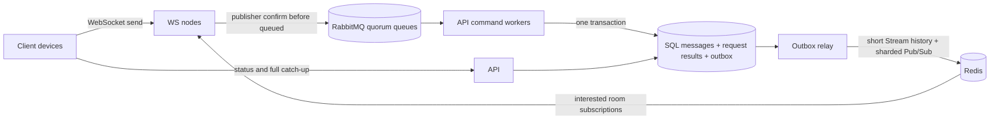

# Messenger architecture overview

The chosen path uses RabbitMQ quorum queues for send requests, SQL for durable messages, and Redis for live room delivery and short recovery. RabbitMQ handles a command before SQL has a copy. Redis handles an event after SQL has saved it. The [broker decision](../docs/adr/0001-messenger-broker-split.md) explains why we keep both.

`queued` follows a RabbitMQ publisher confirm. The worker validates and commits the message, per-chat sequence, request result, and outbox event in one SQL transaction; that commit makes the message `saved`. It then acknowledges the Rabbit delivery. The relay publishes committed outbox events to Redis. A sender's other devices and the recipient's devices receive live events through user rooms; connected group members receive group events through group rooms. Each WS node keeps a local room-to-sockets map and subscribes to Redis once per room with local listeners. [RabbitMQ confirms](https://www.rabbitmq.com/docs/confirms), [Redis Pub/Sub](https://redis.io/docs/latest/develop/pubsub/).

The Redis Stream is a bounded cache of recent room events, not the message database. A reconnecting device first tries to replay a complete short gap from the same room epoch. If it cannot, it fetches SQL messages after its last applied chat sequence. ULIDs identify messages; the SQL sequence is the exact catch-up cursor. Clients ACK their last *applied* position and deduplicate repeated events. Periodic room-node position checks can reveal a silently missed final Pub/Sub event, but Redis-only checks cannot detect every message lost in a Redis failover. A strict live freshness deadline needs a database-backed reconciliation rule or durable delivery ledger. [Centrifugo recovery and positioning](https://centrifugal.dev/docs/server/history_and_recovery), [Redis replication](https://redis.io/docs/latest/operate/oss_and_stack/management/replication/).

For scale, partition the command queues by chat ID and cap backlog with `reject-publish`; do not create a queue per socket or room. Run more workers until SQL becomes the bottleneck. RabbitMQ itself says one queue replica has one CPU core on its hot path. Redis Streams could process send commands too, but default asynchronous Redis replication gives a weaker `queued` acceptance promise before SQL commit. This is a durability choice, not a universal throughput ranking. [RabbitMQ queues](https://www.rabbitmq.com/docs/queues), [queue limits](https://www.rabbitmq.com/docs/maxlength), [Redis replication](https://redis.io/docs/latest/operate/oss_and_stack/management/replication/).

Read the [full architecture](messenger-architecture.md) for component ownership and scaling. The [detailed flow](messenger-detailed-flow.md) has the SQL statements, failure cases, Redis recovery sequence, and MySQL/Vitess path.
