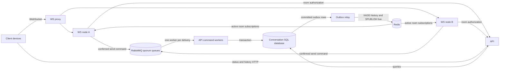

# Messenger architecture

This is the selected architecture for the Messenger example. It supports direct chats, bounded group chats, several devices per user, async sends, and recovery after a missed live event. The [decision record](../docs/adr/0001-messenger-broker-split.md) explains the RabbitMQ and Redis split. The [detailed flow](messenger-detailed-flow.md) shows individual requests, SQL operations, failure branches, and a MySQL/Vitess variant.

## Contract

The client uses four distinct send states. `queued` means a RabbitMQ quorum queue confirmed the request. `saved` means the conversation database committed the message and outbox event. `rejected` means processing ended without a message. `applied` means a particular device incorporated a saved message and acknowledged it. A publisher confirm, SQL commit, Redis publication, WS-node write, and device acknowledgement answer different questions. See the [domain language](../CONTEXT.md).

The durable promise is that a saved message remains available from SQL while the history is retained. A client uses a per-conversation sequence to fetch every saved message after its last applied sequence. Live delivery can repeat or arrive out of order; devices deduplicate by message ID and apply in conversation sequence. A continuously open socket can appear healthy while its broker feed has missed an event, so live freshness also needs position checks and explicit resync. No broker by itself proves device application.

## Running components



The API and command worker may share code or an image, but the worker consumes queue deliveries while the API serves authorization, history, and request-status calls. The outbox relay is another independently retrying process. A PostgreSQL deployment can wake it with `NOTIFY` after commit and still scan the table; a MySQL or Vitess deployment uses polling or change data capture. `NOTIFY` is a wakeup, not the event store. [PostgreSQL NOTIFY](https://www.postgresql.org/docs/current/sql-notify.html), [Vitess VStream](https://vitess.io/docs/25.0/reference/vreplication/vstream/).

## Rooms and fanout

Each WS node keeps `room -> local sockets` and subscribes to one Redis channel for each room with local listeners. It does not create a broker subscription per socket. Every authenticated device joins `user:<id>`. In this design, connected members also join their bounded group rooms after an API membership check, even when the group chat is not open. A direct message targets the sender and recipient user rooms. A group message targets its group room, reaching the sender's other devices too. If group memberships become too numerous, a personal-room inbox notification plus SQL fetch is an alternative with per-recipient fanout cost.

One RabbitMQ queue with several WS-node consumers would give each event to one node, so it cannot broadcast to every node that has group members. RabbitMQ live fanout would need an exchange and a separate queue per WS node, bound to each of its active rooms. That remains a measurable alternative. Avito's old queue-per-connection problem does not measure this queue-per-node topology. [RabbitMQ exchanges](https://www.rabbitmq.com/docs/exchanges), [Avito's engineering account](https://habr.com/ru/companies/avito/articles/522744/).

## Send and publish

```mermaid
sequenceDiagram
    participant C as Sender device
    participant W as WS node
    participant Q as RabbitMQ
    participant K as Command worker
    participant D as SQL database
    participant R as Outbox relay
    participant X as Redis
    participant O as Recipient WS node
    participant B as Recipient device
    C->>W: send(conversationId, requestId, body)
    W->>W: authenticate, check size, apply sender rate limit
    W->>Q: publish persistent command to partitioned quorum queue
    Q-->>W: publisher confirm
    W-->>C: queued(requestId)
    Q->>K: deliver command
    K->>D: BEGIN; dedupe request; lock membership and sequence
    K->>D: insert message, saved result, and room outbox rows
    K->>D: COMMIT
    D-->>K: saved
    K->>Q: ACK command
    R->>D: claim committed outbox rows
    R->>X: append bounded room Stream and publish live
    X-->>W: sender room result
    X-->>O: recipient room event
    W-->>C: saved(requestId, messageId, sequence)
    O-->>B: message(messageId, sequence)
    B-->>O: ACK last applied position
```

The worker stores a stable `requestId` result so Rabbit redelivery or a client retry cannot create a second message. It rechecks authorization and can store `rejected` instead of a message. The sender can query status after reconnect; it might even see `saved` before a late `queued` frame, so client state must never move backwards. SQL commit happens before Rabbit consumer ACK. If the worker crashes between them, Rabbit redelivers and the worker reads the saved result. [RabbitMQ confirms and consumer ACKs](https://www.rabbitmq.com/docs/confirms).

The message, request result, per-conversation sequence, and outbox rows share one SQL transaction. The relay publishes each committed outbox row and marks it complete afterward. A crash after Redis publication and before completion can duplicate the event. The device deduplicates messages by stable message ID and status events by event ID. Redis publication order can differ from SQL conversation order if relays race, so the client uses the SQL sequence to order and fill gaps. ULID remains the message identity, not the catch-up cursor.

For one room, a short Redis Function or Lua script appends to a bounded Stream with `XADD` and sends the live event with `SPUBLISH`. The publication includes an epoch and Stream ID. The Stream is a recovery cache; Pub/Sub is the immediate room transport. The room's Stream and metadata keys must share a Redis Cluster slot. Redis script execution coordinates these Redis operations but cannot transact with SQL. [Redis Pub/Sub](https://redis.io/docs/latest/develop/pubsub/), [Redis scripting](https://redis.io/docs/latest/develop/programmability/eval-intro/), [Redis Cluster](https://redis.io/docs/latest/operate/oss_and_stack/management/scaling/).

## Recovery

The client persists its last **applied** conversation sequence and its last applied `{room, epoch, Stream ID}`. On reconnect, the WS node authorizes the room, establishes its live Redis subscription, buffers live events, then reads missed Stream entries. If the previous entry is retained in the same epoch, it replays the complete short gap and drains the buffer. Redis Stream IDs are monotonic but not gapless, so the node verifies the previous entry rather than subtracting IDs. If history was trimmed or the epoch changed, the client fetches SQL rows with `sequence > lastAppliedSequence` and merges duplicates by message ID.

```mermaid
sequenceDiagram
    participant C as Device
    participant W as WS node
    participant X as Redis
    participant A as API
    participant D as SQL database
    C->>W: subscribe(room, last applied Redis position)
    W->>A: authorize membership
    W->>X: subscribe live; buffer incoming events
    W->>X: check epoch and retained previous Stream entry
    alt Same epoch and complete gap retained
        X-->>W: missed room entries
        W-->>C: replay, then buffered live events
    else Cannot prove complete broker replay
        W-->>C: recovery_failed
        C->>A: GET messages after conversation sequence N
        A->>D: SELECT messages WHERE sequence>N ORDER BY sequence
        D-->>A: saved rows
        A-->>C: catch-up pages
    end
    C->>C: apply in SQL sequence order and persist cursor
    C-->>W: ACK last applied position
```

Redis Pub/Sub is at-most-once. If a WS node loses its Redis link while browser sockets stay open, it marks rooms stale and starts recovery after reconnecting. A later event can expose a gap, but a missed final event has no successor. Periodic comparison of each active room-node position with Redis's room tail can discover that case. At one million active room-node pairs, a naive 30-second interval is about 33,333 checks per second, so batching, interval, and room policy need load tests. A Redis tail check cannot detect a saved message whose publication disappeared during Redis failover after the relay marked the outbox row complete. SQL catch-up on reconnect and chat open remains mandatory; a strict freshness deadline for continuously open sockets needs an additional database-backed reconciliation or durable delivery ledger. [Redis Pub/Sub delivery](https://redis.io/docs/latest/develop/pubsub/), [Centrifugo positioning](https://centrifugal.dev/docs/server/history_and_recovery), [Redis replication](https://redis.io/docs/latest/operate/oss_and_stack/management/replication/).

## Scaling and overload

Use a fixed set of RabbitMQ quorum queues selected by `hash(conversationId)`, rather than one queue per user, room, or socket. Workers consume across the partitions with bounded prefetch. RabbitMQ states that one queue replica has one CPU core on its hot path, so one global queue would be a bottleneck. Partitioning does not remove the SQL row lock for one hot conversation. [RabbitMQ queue scaling](https://www.rabbitmq.com/docs/queues), [consumer prefetch](https://www.rabbitmq.com/docs/consumer-prefetch).

The WS node rate-limits before enqueueing, with a shared per-user limit so reconnecting to another node cannot bypass it. The queues have a measured backlog budget. Configure queue overflow to reject new publishes and return a retryable error before telling a client `queued`; RabbitMQ's default length-limit behavior can discard the oldest queued command. Broker flow control also slows fast publishers. Additional workers help until SQL or one hot conversation becomes the limit. A queue absorbs a bounded burst or short API outage, not sustained overload. RabbitMQ advises against very long backlogs in quorum queues. [RabbitMQ queue limits](https://www.rabbitmq.com/docs/maxlength), [flow control](https://www.rabbitmq.com/docs/flow-control), [quorum queue limits](https://www.rabbitmq.com/docs/quorum-queues).

Redis-only commands are viable with partitioned Streams, `XREADGROUP`, `XACK`, and pending-entry reclaim. They do not inherently scale worse. We keep RabbitMQ because, before SQL commit, its confirmed quorum queue gives `queued` a stronger durability meaning than an `XADD` acknowledged by a Redis primary whose replication is asynchronous. Redis Streams after SQL commit can be lost and rebuilt through SQL catch-up. [Redis consumer groups](https://redis.io/docs/latest/commands/xreadgroup/), [Redis replication](https://redis.io/docs/latest/operate/oss_and_stack/management/replication/), [RabbitMQ quorum queues](https://www.rabbitmq.com/docs/quorum-queues).

Measure publisher-confirm latency, queue depth and age, worker throughput, SQL commit latency, outbox age, Redis publication latency, active room-node pairs, Redis memory, client ACK latency, replay success, SQL fallback rate, and the time to detect one quiet missed event. Test Rabbit failover immediately after `queued`, worker crash before ACK, relay crash after Redis publish, Redis failover, a WS broker-link failure that leaves client sockets open, and a hot group spread across many WS nodes.
