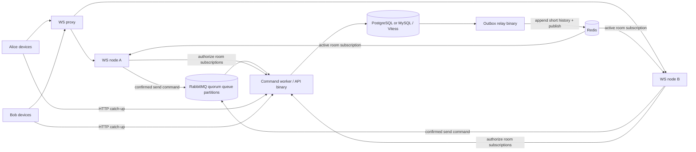

# Messenger: exact send, fanout, and recovery flow

This is the selected design for the Messenger example, not an implemented system. It assumes server-stored chat history, direct chats and bounded group chats, multiple devices per user, and asynchronous send commands. SQL is the authority for saved messages. Redis carries live events and keeps a short replay cache. RabbitMQ quorum queues accept send commands before SQL has a copy. The [decision record](../docs/adr/0001-messenger-broker-split.md) explains the broker split. Timeouts and capacity limits still require load and failure tests.

## Terms and promises

- A **room** is a logical destination. `user:alice` reaches Alice's connected devices. `group:42` reaches connected devices of members of group 42. A WS node maintains `room -> local sockets` and has one Redis subscription per locally active room, not one Redis subscription per socket. In this design, connected group members join their group rooms even if that chat is not open. For very large numbers of memberships, use per-user inbox notifications plus DB fetch instead.
- `requestId` identifies a send attempt across client retries. `messageId` is the stable message identity (ULID). `(conversationId, sequence)` is the authoritative ordered history cursor. `(room, epoch, streamId)` is only the short Redis recovery cursor. These are different identifiers.
- `queued` means a RabbitMQ quorum queue confirmed the command. `saved` means the SQL transaction committed. `applied` means one device acknowledged incorporating the event. Avoid the unqualified word `delivered`; neither `queued` nor `saved` proves device application.
- The application guarantees eventual recovery of **committed** messages while the SQL history is retained, provided clients reconnect or run a catch-up check. It does not promise zero duplicates or bounded live delivery during every network fault. Client and relay retries are expected.

## Components



The relay is a separate long-running process. It can be deployed as another process in the API image, but its lifecycle and retry state are independent of WebSocket connections.

## Why one RabbitMQ queue per room is not broadcast

With a queue `group:42` and two consumers (WS nodes A and B), RabbitMQ distributes each queued delivery to **one** consumer. A may receive message 1 and B message 2, leaving each node's local clients missing the other message. To broadcast through RabbitMQ, publish to an exchange with a room routing key and bind **a separate queue per WS node** to every room that node serves. Each matching queue receives its own copy. This is a viable competing design: queue count follows node count; binding count follows active room-node pairs. It is much less expensive than Avito's old queue-per-connection shape, but binding churn, bind/publish races, queue lifetime, and node move/recovery still need work. RabbitMQ exchange routing and the competing-consumers pattern are documented in [Exchanges](https://www.rabbitmq.com/docs/exchanges) and [Work Queues](https://www.rabbitmq.com/tutorials/tutorial-two-python).

## Joining a room (authorization and race closure)

```mermaid
sequenceDiagram
  autonumber
  participant App as Alice app
  participant Proxy as WS proxy
  participant WS as WS node A
  participant API as API / command service
  participant DB as SQL database
  participant Redis as Redis
  App->>Proxy: HTTP Upgrade /ws + auth token
  Proxy->>WS: forward upgrade and socket bytes
  WS->>API: validate token/session
  API-->>WS: Alice identity, session validity
  WS-->>App: WebSocket established
  App->>WS: subscribe group:42 + lastApplied cursor
  WS->>API: authorize Alice for group 42
  API->>DB: SELECT membership WHERE user=Alice AND conversation=42
  DB-->>API: active member + membership version
  API-->>WS: allow + version
  WS->>WS: register local socket; mark room catching-up
  opt First local listener for room
    WS->>Redis: SSUBSCRIBE room:{42}:live
    Redis-->>WS: subscription acknowledged
  end
  WS->>WS: buffer incoming live events for this socket
  WS->>Redis: read epoch, retained cursor and tail of stream:{42}
  alt Cursor retained in same epoch
    WS->>Redis: XRANGE entries after lastApplied stream ID
    Redis-->>WS: replay entries
    WS-->>App: replay entries in stream order
  else Cursor absent or epoch changed
    WS-->>App: recovery_failed; request DB catch-up
    App->>API: GET /conversations/42/messages?afterSeq=N
    API->>DB: SELECT ... WHERE conversation_id=42 AND seq>N ORDER BY seq LIMIT ...
    DB-->>API: committed rows
    API-->>App: messages + next cursor
  end
  WS-->>App: buffered live events after replay (dedupe by messageId)
  App->>App: apply in conversation sequence; persist cursor
  App-->>WS: applied ACK with last DB sequence and Redis cursor
```

Subscribe **before** reading history and buffer live traffic while replaying. Otherwise an event can fall between the history read and the live subscription. The API must also reject or end a subscription when membership is revoked; a long-lived authorization decision is not sufficient. A fresh client without a valid Redis cursor starts from SQL. Redis stream IDs are monotonic but not gapless; check that the previous stream entry itself is retained, not whether IDs differ by one.

## Sending one direct message: successful path

The example sends one logical direct-chat message to Alice's and Bob's personal rooms. A group message has one `group:42` outbox destination in this design; all connected members, including Alice's other devices, subscribe to that group. The two personal-room publications for a direct chat are separately retryable. Room events contain `conversationId`, `sequence`, `messageId`, and `requestId` for Alice's status. A recipient must still be authorized when subscribing or fetching history.

```mermaid
sequenceDiagram
  autonumber
  participant A as Alice app
  participant P as WS proxy
  participant W as WS node A
  participant Q as RabbitMQ
  participant C as Command worker / API
  participant D as SQL primary
  participant R as Outbox relay
  participant X as Redis
  participant WB as WS node B
  participant B as Bob app
  A->>P: WS send {conversationId=7, requestId=r9, body}
  P->>W: forward frame
  W->>W: validate size/shape; authenticate socket; rate-limit sender
  W->>Q: basic.publish persistent command to hash(conversationId) queue
  Q-->>W: publisher confirm (command accepted by broker)
  W-->>P: queued(r9)
  P-->>A: queued(r9)
  Q->>C: basic.deliver command r9
  C->>D: BEGIN
  C->>D: INSERT send_requests(7,Alice,r9,status=processing) ON CONFLICT DO NOTHING
  alt Request already has final result
    C->>D: SELECT status,messageId,seq FROM send_requests WHERE key=(7,Alice,r9)
    D-->>C: existing saved/rejected result
    C->>D: ROLLBACK or COMMIT read-only path
    C->>Q: basic.ack duplicate command
  else First processing attempt
    C->>D: SELECT membership for Alice in 7 FOR SHARE
    alt Membership inactive or command invalid
      C->>D: UPDATE send_requests SET status=rejected,reason WHERE key=(7,Alice,r9)
      C->>D: INSERT outbox(rejectionEventId,room=user:Alice,payload)
    else Membership active and command valid
      C->>D: UPDATE conversation_counter SET next_seq=next_seq+1 WHERE id=7 RETURNING assigned seq
      D-->>C: seq=104 (row lock serializes sends to conversation 7)
      C->>D: INSERT messages(7,104,messageId,Alice,body)
      C->>D: UPDATE send_requests SET status=saved,messageId,seq WHERE key=(7,Alice,r9)
      C->>D: INSERT outbox(eventId,room=user:Alice,payload)
      C->>D: INSERT outbox(eventId,room=user:Bob,payload)
    end
    opt PostgreSQL wakeup mode
      C->>D: SELECT pg_notify('outbox_changed','7')
    end
    C->>D: COMMIT
    D-->>C: commit succeeded: saved or rejected result is durable
    D-->>R: NOTIFY wakeup after commit (PostgreSQL only)
    C->>Q: basic.ack command
    R->>D: BEGIN
    R->>D: SELECT pending outbox rows FOR UPDATE SKIP LOCKED LIMIT batch
    D-->>R: claimable committed rows
    R->>D: UPDATE outbox SET lease_owner, lease_until for claimed IDs
    R->>D: COMMIT (release row locks)
    loop Once for each room event
      R->>X: FCALL publish_room(room,eventId,payload)
      X->>X: XADD bounded room stream; obtain stream ID
      X->>X: SPUBLISH room channel with epoch, stream ID, payload
      X-->>R: stream ID / operation result
      R->>D: UPDATE outbox SET delivered_at=now WHERE id=? AND lease_owner=?
    end
    X-->>W: Alice room result event (if node A is subscribed)
    alt Accepted message
      X-->>WB: Bob room event (if node B is subscribed)
      W-->>P: message_saved(r9,messageId,seq=104)
      P-->>A: message_saved(r9,messageId,seq=104)
      WB-->>B: message(messageId,conversation=7,seq=104)
      A->>A: dedupe and apply; pending -> saved
      B->>B: dedupe and apply to local history
      A-->>W: applied ACK(seq=104, room cursor)
      B-->>WB: applied ACK(seq=104, room cursor)
    else Rejected command
      W-->>P: send_rejected(r9,reason)
      P-->>A: send_rejected(r9,reason)
    end
  end
```

`COMMIT` and outbox publication are intentionally separate. The relay exists because a process can crash between SQL commit and Redis publish. It continuously drains the *committed* outbox until no work remains. `NOTIFY` only wakes it sooner; the table is the record of work. The relay also polls on a timer after startup and while idle, because notification receipt and process uptime are not durable. First establish `LISTEN`, then scan pending rows to close the startup race. [PostgreSQL NOTIFY](https://www.postgresql.org/docs/current/sql-notify.html), [LISTEN](https://www.postgresql.org/docs/current/sql-listen.html).

The diagram shows a readable ordering, but Rabbit delivery, publisher confirmation, `queued`, and `saved` are asynchronous. Alice could see `saved` before `queued`. The client uses `requestId` and a monotone status rule so a late `queued` response never changes `saved` back to `queued`. The relay's final outbox update is its own short SQL transaction (or autocommit statement), not part of the earlier message transaction.

The WS node should apply a cheap local limit before enqueueing; a shared per-user limit prevents the sender from bypassing it by reconnecting to another node. The command queues need a bounded backlog with `reject-publish` overflow. RabbitMQ's default queue length limit can drop the oldest entry, which would violate the meaning of `queued`. If publish is rejected or no confirmation arrives, the WS node must not say `queued`. Queueing buys time during a short API outage or scale-up, but it does not create infinite capacity. After a confirmed command, the sender needs a `GET /send-status/{requestId}` path because its WebSocket may disconnect before the saved or rejected event arrives. [RabbitMQ queue limits](https://www.rabbitmq.com/docs/maxlength).

For a production implementation, the outbox claim and completion statements need indexes, bounded batches, expired-lease reclamation, and a poison-event policy. A relay can crash **after** Redis publication but **before** marking `delivered_at`; it will publish again after the lease expires. The WS app deduplicates on stable `messageId` (or event ID for non-message events). Redis script execution serializes its steps from other clients' viewpoint, but a script is not a SQL transaction and runtime errors after a write do not roll back prior Redis writes. Keep the function short and prevalidate its inputs. [Redis scripting](https://redis.io/docs/latest/develop/programmability/eval-intro/), [Redis on rollbacks](https://redis.io/blog/you-dont-need-transaction-rollbacks-in-redis/).

The SQL sequence counter and idempotency state must be updated in one transaction. A lock on a single counter row makes accepted messages for that conversation commit in sequence; it also limits the maximum throughput of one extremely hot conversation. The relay might publish sequence 105 before 104 if separate workers claim rows out of order. Clients therefore use SQL `sequence` to order messages and fetch a missing sequence; Redis stream order only describes publication order. An alternative is partitioning the relay by conversation and processing each partition in sequence, at the cost of more coordination.

## What the PostgreSQL wakeup actually does

`LISTEN outbox_changed` registers the relay's dedicated DB connection. `pg_notify('outbox_changed', '7')` inside the worker transaction sends a small signal only **after commit**. The payload `7` can mean "conversation 7 has work"; it is not the message and should not be treated as durable delivery. A transaction that rolls back emits no signal. If the relay is disconnected when the signal is sent, it later finds the row by scanning `outbox`. Multiple notifications can be coalesced in one transaction. At very high message rates, a notification per message may add avoidable overhead; batch notifications or use adaptive polling / change data capture after measuring it. [PostgreSQL NOTIFY](https://www.postgresql.org/docs/current/sql-notify.html).

## Redis history, periodic checks and recovery

For each room, the relay's Redis function appends a short event to `stream:{room}` with `XADD` and publishes the event plus its returned stream ID via `SPUBLISH` to `live:{room}`. Keep stream and room metadata keys in the same Redis Cluster slot. Maintain an epoch that changes when a room history is recreated, and trim by age/size. The stream is a bounded cache, not the full message history. A separate Redis deployment for Pub/Sub and Streams is optional capacity isolation, not a correctness requirement; putting them on separate Redis instances loses the simple same-server function and needs explicit ordering/recovery design. Redis says Pub/Sub itself is at-most-once. [Redis Pub/Sub](https://redis.io/docs/latest/develop/pubsub/), [Redis Streams](https://redis.io/docs/latest/develop/data-types/streams/), [Redis scripting](https://redis.io/docs/latest/develop/programmability/eval-intro/).

```mermaid
sequenceDiagram
  autonumber
  participant X as Redis
  participant W as WS node B
  participant B as Bob app
  participant API as API
  participant DB as SQL history
  X-->>W: live event at room stream ID s10
  W-->>B: message seq=104, stream=s10
  B->>B: apply and persist lastApplied=(epoch,s10), DB seq=104
  B-->>W: ACK applied s10 / seq104
  Note over X,W: Broker connection silently misses the next and final event s11
  loop Periodic room-node position check, e.g. measured interval
    W->>X: read room epoch and latest stream ID
    X-->>W: same epoch, latest=s11
    W->>W: latest differs from last received s10; mark room stale
  end
  W->>X: verify s10 still retained; XRANGE after s10
  alt s10 retained and epoch matches
    X-->>W: s11 event
    W-->>B: replay message seq=105, stream=s11
    B-->>W: ACK applied s11 / seq105
  else Cursor absent, stream trimmed, or epoch changed
    W-->>B: recovery_failed / sync from SQL
    B->>API: GET messages after DB seq104
    API->>DB: SELECT ... WHERE conversation_id=? AND seq>104 ORDER BY seq
    DB-->>API: seq105 and any later rows
    API-->>B: durable history page(s)
    B->>B: apply, dedupe, persist new DB cursor
  end
```

A later event can reveal an order problem sooner, but a missed **last** event has no later event to expose it. This is why Avito's Redis/Centrifugo design used periodic position synchronization, and Centrifugo documents periodic positioning checks. One check per active **room-node** is cheaper than one per socket, but millions of active personal rooms still mean millions of checks per interval. At 1,000,000 active room-node pairs and a 30-second interval, the naive rate is about 33,333 Redis checks/second before batching or jitter. Choose the interval from the maximum acceptable stale time and measured broker load; 30 seconds is an experiment, not a guarantee. Check on reconnect, app focus, and when a user opens a chat as well. If a quiet, healthy-looking socket must learn of a missed final message within a strict deadline and checks cost too much, use a durable node feed or another delivery ledger. [Avito engineering write-up](https://habr.com/ru/companies/avito/articles/522744/), [Centrifugo recovery](https://centrifugal.dev/docs/server/history_and_recovery).

Even a room-node check only says the node saw the room's latest broker position. Clients still ACK their own *applied* position. On slow-client queue overflow, the WS node stops claiming a healthy live view, closes/resyncs that socket, and the client fetches by SQL sequence. If the Redis epoch changes or Redis loses an acknowledged recent write during failover, SQL remains the recovery authority. A Redis-tail check cannot discover a SQL-saved message if the relay marked its outbox row complete and the Redis publication then disappeared. Reconnect and chat-open SQL catch-up remain mandatory. A strict freshness deadline for a continuously open socket needs a database-backed reconciliation rule or durable delivery ledger. Redis replication is asynchronous. [Redis replication](https://redis.io/docs/latest/operate/oss_and_stack/management/replication/).

## Failure branches and observable client states

| Point of failure | What happens | Recovery |
| --- | --- | --- |
| WS node cannot publish the command or receive Rabbit publisher confirm | Client has no reliable `queued` result. | Retry with same `requestId`; query request status after reconnect. A timed-out confirm may have succeeded, so dedupe is essential. |
| Rabbit delivers twice or worker crashes before `basic.ack` | Same command is handled again. | Unique request key returns the previous saved/rejected result; no second message. |
| Membership invalid, message too large, or user rate-limited | WS rejects before queue when possible; worker rechecks authorization and records durable rejection for queued commands. | Publish rejection to sender room, or let sender query `requestId` status if live notification is missed. |
| SQL commit fails | No saved message and no committed outbox row. | Worker may retry transient failures; permanent failure produces a durable rejection result. Never send `saved` before commit. |
| SQL commits but worker crashes before Rabbit ACK | Rabbit redelivers. | Idempotency lookup sees committed result; ACK duplicate. Outbox relay still runs. |
| SQL commits but relay/Redis is down | Message is saved but not yet live. | Pending outbox row stays in SQL and is retried. Clients can also fetch SQL history. |
| Relay publishes then crashes before marking outbox done | Redis may receive the event again. | Client deduplicates `messageId` / event ID. Mark outbox complete only after publish returns. |
| Redis publication reaches Alice's node but not Bob's | Alice sees it; Bob's socket may appear healthy. | Node detects broker disconnection, or position check finds newer Redis tail; if history gone, Bob fetches SQL. |
| Redis history trimmed or failover loses it | Broker cursor cannot prove complete replay. | Return `recovery_failed`; client uses SQL `(conversationId, sequence)` cursor. |
| WS node sends to Bob but Bob does not apply | Node's bounded pending ACK times out or socket breaks. | Retry if safely bounded, otherwise force resync; Bob fetches SQL. |
| Bob is offline | No live WS delivery exists. | On reconnect/open, fetch SQL history from last persisted conversation sequence. Push notification is a separate best-effort wakeup path. |
| Group membership revoked | Existing socket could otherwise keep receiving group room traffic. | Versioned authorization/revocation event removes socket from room; DB history endpoint enforces membership. The revocation path needs its own recovery check; do not rely solely on a lossy Pub/Sub revocation. |

## MySQL, then Vitess

The core transaction works with InnoDB too: `START TRANSACTION`; insert/lock the idempotency key; check membership with a locking read; update one conversation counter row; insert message and outbox rows; `COMMIT`. MySQL 8.4 supports `SELECT ... FOR UPDATE SKIP LOCKED` for queue-like outbox tables. The SQL syntax and lock behavior differ slightly, but the *same-database outbox* principle does not depend on PostgreSQL. [MySQL locking reads](https://dev.mysql.com/doc/refman/8.4/en/innodb-locking-reads.html), [MySQL SELECT](https://dev.mysql.com/doc/refman/8.4/en/select.html).

MySQL has no PostgreSQL `LISTEN/NOTIFY` equivalent. Use a short-interval indexed outbox poller, or consume committed outbox inserts from MySQL's row-based binlog. In Vitess, `VStream` exposes row change streams through `vtgate`, including across shards, and supports resumable CDC workflows. Keep the outbox table as the durable fallback if CDC checkpoints or retention fail. A VStream relay checkpoints only after downstream publication; a crash between publication and checkpoint can duplicate events. [MySQL replication/binlog](https://dev.mysql.com/doc/refman/8.4/en/replication.html), [Vitess VStream](https://vitess.io/docs/25.0/reference/vreplication/vstream/).

For Vitess, shard `conversations`, `memberships`, `conversation_counters`, `messages`, `send_requests`, and `outbox` by `conversation_id`, with matching Vindex placement. One send transaction then stays on one shard. A user-centric conversation list, unread count, or search index can be a separate projection updated asynchronously from committed events. Updating a user-sharded inbox in the same transaction as a conversation-sharded message would cross shards. Vitess supports cross-shard 2PC, but documents its latency and isolation costs; prefer single-shard writes for this path. A single very hot conversation still contends on its counter row; Vitess adds shards for many conversations, not unlimited writes to one conversation. [Vitess sharding guidelines](https://vitess.io/docs/25.0/user-guides/vschema-guide/sharding-guidelines/), [distributed transactions](https://vitess.io/docs/24.0/reference/features/distributed-transaction/), [shared Vindexes](https://vitess.io/docs/23.0/user-guides/vschema-guide/shared-vindexes/).

```mermaid
sequenceDiagram
  autonumber
  participant C as Command worker
  participant G as vtgate
  participant T as vttablet for conversation shard
  participant M as MySQL primary for shard
  participant V as VStream relay
  participant X as Redis
  C->>G: START TRANSACTION; all statements carry conversation_id
  G->>T: route transaction to one shard
  T->>M: START TRANSACTION
  C->>G: idempotency + membership + counter + message + outbox SQL
  G->>T: route all SQL to same shard
  T->>M: execute row locks and inserts
  C->>G: COMMIT
  G->>T: commit single-shard transaction
  T->>M: COMMIT; write row changes to binlog
  M-->>T: commit result
  T-->>G: success
  G-->>C: saved
  V->>G: VStream subscribe from checkpoint to outbox changes
  G-->>V: committed outbox insert event
  V->>X: append short history and publish live
  X-->>V: publish operation returned
  V->>V: persist CDC checkpoint after publication
```

Vitess can combine changes from shards in a VStream, but it cannot provide exact global ordering across shards. That is fine here because ordering is per conversation and each conversation is on one shard. [Vitess VStream skew detection](https://vitess.io/docs/25.0/reference/vreplication/internal/vstream-skew-detection/).

## Could Redis Streams replace RabbitMQ too?

Yes. Partition send commands among several Redis Streams, with a consumer group of API workers for each partition:

```text
WS node --XADD--> command Stream --XREADGROUP--> API worker
                                             --SQL COMMIT--> message + outbox
                                             --XACK-------> command Stream

Outbox relay --XADD--> short room Stream --XREAD, separate cursor per WS node--> devices
```

Workers reclaim abandoned pending commands with `XAUTOCLAIM` and use the stable `requestId` to make retries safe. A command Stream needs a retention rule that does not remove unprocessed commands: default `XTRIM` may remove an entry while its pending reference survives. Redis 8.2 added `XTRIM ... ACKED` to trim only entries acknowledged by all groups. Keep command Streams separate from bounded room-history Streams because their retention and reader semantics differ. [Redis consumer groups](https://redis.io/docs/latest/commands/xreadgroup/), [XAUTOCLAIM](https://redis.io/docs/latest/commands/xautoclaim/), [XTRIM](https://redis.io/docs/latest/commands/xtrim/).

The durability distinction is **when SQL has no copy yet**. The WS node could receive a successful `XADD` response and tell Alice `queued`, then Redis could fail over to a replica that lacks that command. There would be no SQL message or outbox row to recover. Redis's default replication is asynchronous. `WAIT` and `WAITAOF` reduce the loss window but do not make Redis a strongly consistent quorum system under all failovers. A confirmed RabbitMQ quorum-queue publication has a stronger documented conditional promise: it survives while a majority of queue replicas remain available. That promise costs replication and disk work on the command path. [Redis replication](https://redis.io/docs/latest/operate/oss_and_stack/management/replication/), [WAITAOF](https://redis.io/docs/latest/commands/waitaof/), [RabbitMQ quorum queues](https://www.rabbitmq.com/docs/quorum-queues).

Redis-only is therefore a valid choice if `queued` is a weaker, retryable receipt and the client retains and retries a send until it sees `saved` or `rejected`. If `queued` must survive the sender going offline before SQL commit, keep a quorum command queue or persist the command in SQL before acknowledging it. This is the reason to combine RabbitMQ for commands with Redis for live room traffic; it is not a claim that Redis Streams scale poorly in general.

Using Streams for **live room fanout** is also possible. WS nodes independently `XREAD` each active room Stream from their own cursors, so each interested node receives each entry. They must not share one `XREADGROUP` consumer group, because that splits entries among nodes. A healthy reader resumes from its cursor without a separate Pub/Sub history check. Use a bounded blocking timeout and reconnect/cursor comparison to discover a stalled reader; an indefinitely blocked connection is not proof that the node received the latest event. This design maintains many room streams and active readers. Redis documents that an `XADD` waking blocked readers incurs work proportional to the number waiting on that stream. A single global command Stream also belongs to one Redis Cluster slot, so use multiple streams if one slot becomes hot. RabbitMQ queues have their own per-queue leader and likewise require partitioning at large throughput. [Redis XREAD](https://redis.io/docs/latest/commands/xread/), [Redis XREADGROUP](https://redis.io/docs/latest/commands/xreadgroup/), [Redis Cluster](https://redis.io/docs/latest/operate/oss_and_stack/management/scaling/), [RabbitMQ queues](https://www.rabbitmq.com/docs/queues).

## Selected broker split and scaling tests

The selected design uses RabbitMQ quorum queues for send commands and Redis sharded Pub/Sub plus short room Streams after SQL commit. `queued` is meant to survive Alice going offline before SQL saves the message, under the quorum queue's documented majority-survival assumption. Redis-only commands remain a valid alternative with a weaker `queued` promise and client retries. Redis Streams do not inherently scale worse; the difference is the safety of the only pre-SQL command copy. [RabbitMQ quorum queues](https://www.rabbitmq.com/docs/quorum-queues), [Redis replication](https://redis.io/docs/latest/operate/oss_and_stack/management/replication/).

Use a fixed pool of command queues selected by `hash(conversationId)`, not one global queue and not one queue per room or socket. RabbitMQ says a single queue replica has one CPU core on its hot path. Workers use bounded prefetch. Add workers until SQL commit throughput or one hot conversation's sequence row becomes the limit. Set a maximum queue length or byte budget and `reject-publish`, then measure publisher-confirm latency and queue age during bursts. RabbitMQ applies publisher flow control when the queue cannot keep up, and its quorum-queue guide discourages very long backlogs. [RabbitMQ queues](https://www.rabbitmq.com/docs/queues), [prefetch](https://www.rabbitmq.com/docs/consumer-prefetch), [flow control](https://www.rabbitmq.com/docs/flow-control), [queue limits](https://www.rabbitmq.com/docs/maxlength), [quorum queue limits](https://www.rabbitmq.com/docs/quorum-queues).

Measure Redis room-node subscriptions, publish-to-device-ACK latency, Stream memory, recent replay rate, and SQL fallback rate separately from the command queue. Test Rabbit failover immediately after `queued`, a worker crash before ACK, a reconnect storm, the quiet missed-final-event case, and a hot group with many WS-node readers. The result should set partition count, backlog budget, Stream retention, and position-check interval.
