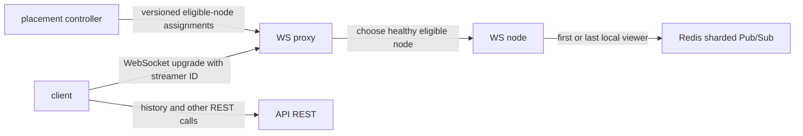
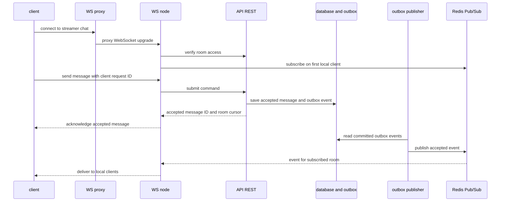
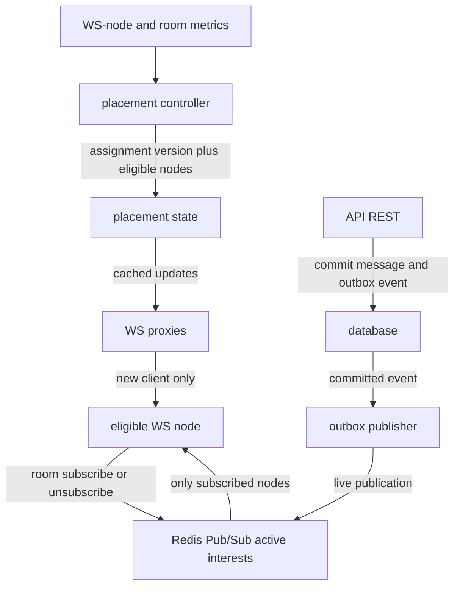

# Twitch-like chat: routing and scaling decision

## Scope and terms

This project has many streamer chats. Most are small. Some have about 400,000 connected clients and a high publish rate. Assume a client watches one streamer chat per WebSocket connection. If one socket joins several streamer chats, the WS proxy cannot place it with all those chats at once; that weakens room-aware placement. The **WS proxy** accepts the client's connection and chooses a **WS node**. The WS node holds the socket. The **API (REST)** checks permissions, accepts chat messages, saves history, and exposes recovery. A **placement controller** decides which WS nodes may accept new clients for each chat. A **broker** distributes accepted messages to WS nodes that have clients in a chat. The last two are internal components, not the browser frontend.

Two decisions must remain separate:

1. Connection placement: which WS node holds a new client's socket?
2. Message delivery: which WS nodes have clients in this chat right now?

The second set must include old WS nodes while they drain. It is not necessarily the first set.

## What established systems actually show

[Ably's architecture](https://ably.com/docs/platform/architecture/platform-scalability) sends connections to any connection-serving node according to load. A consistent hash selects the processor for a channel, not the WS node for every client of that channel. The channel processor tracks which connection-serving nodes have subscribers and sends one copy to each interested node. Each node sends it to its local clients. Ably says a single channel with a very high message rate can hit its one processor's limit. It does not document per-channel placement of clients onto a chosen subset of connection-serving nodes.

[Discord's large-community account](https://discord.com/blog/maxjourney-pushing-discords-limits-with-a-million-plus-online-users-in-a-single-server) describes a central guild process and relay processes that split fanout across machines. It also reports that making most sessions passive removed much delivery work. A Discord guild is not the same as a Twitch chat, but this is a first-party example of multi-machine fanout for one large recipient group. It does not establish that Discord routes client connections by room.

[Centrifugo's Redis study](https://centrifugal.dev/blog/2026/06/29/scaling-redis-pub-sub) supports exact subscriptions at large channel counts and discusses sharded Pub/Sub, batching, and reconnect costs. A WS node with clients in a room subscribes to that room. This keeps an interest set in Redis; it does not require the API to query a `room -> WS nodes` table for every publish. Redis Pub/Sub has [at-most-once delivery](https://redis.io/docs/latest/develop/pubsub/), so it is a live transport, not durable history.

The room-aware placement policy below is **our proposed design**. The sources above support interested-node and tiered fanout. They do not prove that this placement policy is the standard or the best policy for Twitch.

## Compare the placements

| Choice | How the WS proxy chooses a node | Benefit | Cost |
| --- | --- | --- | --- |
| A. Capacity-based balancing | Any healthy WS node with spare capacity | Simple placement and fleet scaling; established pattern in Ably's description | A popular chat can have clients on nearly every WS node, so each accepted message reaches many nodes |
| B. Hash streamer ID to an elastic pool | Hash to one pool, then choose a node inside it | Limits a room to its pool without a per-room node list | A single hot room may force growth of the whole pool; pool resize and room moves cause transition work; rooms share capacity and failure fate within the pool |
| C. Elastic per-room assignment | Look up the chat's eligible WS-node set, then choose a node with spare capacity | Can use roughly as many nodes as that chat needs, even with a much larger fleet | Controller, assignment state, WS proxy integration, and controlled draining |

Choice B only reduces work when pools remain much smaller than the fleet. If it uses `hash(streamerId) -> one WS node`, it recreates the Kanban size limit and cannot serve a room larger than one node. If a room grows, the pool must grow. A deterministic top-`K` hash over healthy nodes can replace an explicit node list, but every WS proxy must agree on `K`, node membership, and an assignment version. It also cannot move existing WebSockets. Thus it reduces stored placement state, not control work.

**Recommended system to build:** implement A with exact interested-node fanout as the reference architecture at the target load. Add C as a measured alternative in the same project. Do not select C as the production recommendation solely because a room has 400,000 clients. Select it when a room can safely use far fewer WS nodes than the fleet and internal fanout cost is a measured limit. B is useful as a short routing experiment but does not add enough to be the main architecture. This is a teaching comparison of peer designs, not a small-scale first release followed by a serious one.

## Why room size does not settle the choice

Let `R` be clients in one chat, `M` accepted messages per second, `G` total WS nodes, and `K` WS nodes currently holding that chat's clients. A message reaches `K` WS nodes, then approximately `R` clients. The socket-write load is about `R × M` deliveries per second. Moving clients onto fewer WS nodes can reduce `K`. It cannot reduce `R × M` if every client must see every accepted message.

At `R = 400,000` and `M = 50`, the system attempts 20 million client deliveries per second. With a 200-byte payload, the payload alone is about 4 GB/s across the WS nodes, before framing, transport overhead, and retries. Those figures are arithmetic examples, not measured capacity. Even if room-aware placement cuts broker deliveries from 200 WS nodes to 40, client delivery remains 20 million per second. Conversely, if safe outbound write capacity requires 200 WS nodes, 40 nodes are not an option. [Discord's post](https://discord.com/blog/maxjourney-pushing-discords-limits-with-a-million-plus-online-users-in-a-single-server) explains the multiplication of senders and recipients in large communities.

Here is an explicit test with **hypothetical** capacity of 100,000 client writes per second per WS node. At 50 accepted messages per second, this room needs at least 200 WS nodes for writes alone, plus failure headroom. With one spare node, the room-aware target is at least 201. Normal balancing will place clients from such a large room on nearly every WS node in a fleet of either size shown.

| Total fleet `G` | Normal placement copies per message | Room-aware minimum copies per message | Broker-copy reduction | Client writes per second |
| ---: | ---: | ---: | ---: | ---: |
| 250 | About 250 | At least 201 | Up to 20% | 20 million in both cases |
| 1,000 | About 1,000 | At least 201 | Up to 80% | 20 million in both cases |

At 200 bytes per event and 50 events per second, the second row saves about 8 MB/s of broker-to-WS-node payload while client payload still totals about 4 GB/s. That does not prove the saving is unimportant. A single room processor may spend significant CPU sending 50,000 rather than about 10,000 internal copies per second. It does show why `K/G` and measured processor cost, not `R` alone, must decide whether room-aware placement pays for itself.

For each chat, estimate the minimum safe node count from measured limits:

```text
requiredNodes = max(
  ceil(clients / safeConnectionsPerNode),
  ceil(clients * acceptedMessagesPerSecond / safeWritesPerSecondPerNode),
  ceil(clientOutboundBytesPerSecond / safeOutboundBytesPerSecondPerNode)
)
```

These per-node limits must be measured under the same message size, TLS, compression, number of rooms, and slow-client mix as the project. Add failure headroom and account for other chats sharing the nodes. If `requiredNodes` is close to `G`, C saves little. If `requiredNodes` is much smaller than `G`, C may save many broker copies. Compare broker CPU and bandwidth, processor fanout time, client p95 latency, WS-node CPU and egress, and the disruption caused by resizing. There is no useful universal numerical cutoff.

## Architecture and message path

Use Redis sharded Pub/Sub channels such as `chat:<streamerId>` for live delivery. A WS node keeps a local client count for each chat. When the count changes from zero to one, it subscribes. When it falls to zero, it unsubscribes after a short delay to avoid join/leave churn. Redis then routes a live event to only the WS nodes subscribed to that room. This is exact interested-node routing, whether A or C places the connections. Centrifugo documents the scaling and reconnect costs of this approach. [Centrifugo's Redis study](https://centrifugal.dev/blog/2026/06/29/scaling-redis-pub-sub).



The WS proxy reads the streamer ID from the HTTP upgrade path, for example `/ws/chats/streamer-123`, before it creates the tunnel. With C, it asks a local assignment cache for eligible nodes and picks one with spare connection and outbound budget. With A, it chooses any healthy node with capacity. The WS node must authenticate the client and check room access; the URL is only a routing key. The WS proxy holds a client-side and a WS-node-side connection for the lifetime of the tunnel. [NGINX documents this WebSocket proxy behavior](https://nginx.org/en/docs/http/websocket.html).

One concrete proxy implementation is NGINX with an HTTP subrequest to a small placement service during the handshake. The service returns a trusted internal WS-node address; `auth_request_set` copies that response field to a variable used by `proxy_pass`. The placement service reads an in-memory assignment snapshot, so there is no datastore read per message or per handshake. This is an implementation proposal based on [NGINX `auth_request_set`](https://nginx.org/en/docs/http/ngx_http_auth_request_module.html), [variable `proxy_pass`](https://nginx.org/en/docs/http/ngx_http_proxy_module.html), and [WebSocket proxying](https://nginx.org/en/docs/http/websocket.html). Validate and restrict returned addresses to registered internal WS nodes. A custom WS proxy could instead keep the snapshot directly, but then it must handle long-lived connection load itself. A discovery REST endpoint that returns a signed node-specific WebSocket URL is another option; it adds a client round trip and node addressing to the client contract.



The diagram combines sender and recipient views; one published event goes to every subscribed WS node, not only the sender's node. The API applies rate limits, permissions, and moderation before it accepts a message. It saves the accepted message and an outbox record in one database transaction. A publisher drains the outbox and sends the event to the live broker. The [Debezium outbox documentation](https://debezium.io/documentation/reference/stable/transformations/outbox-event-router.html) explains why the durable write and event must be tied together. A Redis outage can delay live publication, and Pub/Sub cannot replay a message missed by a subscriber. Each event therefore carries a message ID and a room cursor. The client uses `GET /chats/:id/messages?after=<cursor>` after reconnect or a detected gap. Send a periodic latest-cursor watermark so a quiet channel can reveal a gap too. Make the outbox publisher and client idempotent by message ID, because retries can duplicate a live event. If strict room-wide order is required, serialize accepted messages per room or add a room sequencer, then publish in cursor order. One sequencer can become a hot-room bottleneck; [Ably notes this limit for one high-rate channel](https://ably.com/docs/platform/architecture/platform-scalability).

Joining needs a small protocol. The WS node creates and confirms its broker subscription before it marks the client ready. It records a room cursor, reads history after that cursor, and buffers or deduplicates live events while the client catches up. Otherwise a message can land between the history read and the live subscription. If the client's requested cursor has expired from retained history, the API returns a clear gap response and the client loads a fresh bounded history view.

## Placement state, controller, and scale changes

Keep these records distinct:

| State | Owner | Why it exists |
| --- | --- | --- |
| Healthy WS nodes and measured spare capacity | Placement controller | Candidate nodes for new connections |
| `eligible(chat)`, version, and target node count | Placement controller; cached by WS proxies | Where the WS proxy may place a new client |
| Current local clients and local room count | Each WS node | Which sockets receive the event locally |
| `active(chat)` interest | Redis subscriptions held by WS nodes | Which WS nodes receive each live message |
| Accepted messages and room cursor | API database | History and recovery |

The broker's subscriptions are the `active(chat)` routing state. The API does **not** look up a per-room WS-node list on each publish. That state is separate from `eligible(chat)`, the placement state at the WS proxy. An external durable room-to-node directory would duplicate Redis's live interest state for this implementation.



The controller samples per-node connections, CPU, egress, pending socket-write bytes, and fanout lag. Per chat, it samples viewer count, accepted message rate, average event size, and growth. It calculates a target node count from load tests and N-1 failure headroom. It selects healthy nodes with spare aggregate capacity, adds them to `eligible(chat)`, and publishes a new assignment version. A concrete assignment record contains `chatId`, `version`, `eligibleNodeIds`, and a drain status for removed nodes. The controller stores it durably; WS proxies receive changed records and keep local snapshots. Only the WS proxy's handshake decision reads a snapshot. New clients can enter the new node. Established WebSockets stay on old nodes, so adding capacity alone does not relieve overloaded old nodes. If necessary, the controller drains a bounded number of clients, and the clients reconnect with jitter and request missed history. Do not change an assignment for every small metric change; use a sustained threshold and cooldown.

Scaling the WS-node fleet and assigning a chat are separate loops. A fleet autoscaler adds healthy WS nodes when aggregate spare capacity is low. The placement controller can assign only nodes that already passed readiness checks. When the fleet shrinks, the controller drains assignments and sockets before the autoscaler removes the node. For one hot room, add enough nodes to cover its connection, write, and bandwidth demand. For many rooms, count each assigned room's predicted load against every chosen node's remaining capacity. Do not assume that two rooms placed on one node each get the node's full capacity.

On scale-in, remove a node from `eligible(chat)` first. It remains subscribed and receives messages while it has clients. Allow natural departures, then close a bounded number of remaining sockets with a drain notice and reconnect jitter. It unsubscribes after its final local client leaves. On a WS-node crash, its Redis connection disappears, clients reconnect through a healthy WS proxy, and the new WS node subscribes to the room. Their room cursors recover the gap. The fleet must have spare capacity before this failure. If the WS proxy's assignment cache is stale, it retries a different healthy eligible node or refreshes the assignment; it must not silently route a client to an unrelated node merely to complete a connection.

```mermaid
stateDiagram-v2
    [*] --> Eligible: controller assigns WS node
    Eligible --> Active: first client connects and node subscribes
    Active --> Draining: controller stops new connections
    Draining --> Removed: last client leaves; node unsubscribes
    Active --> Failed: WS node crashes
    Failed --> [*]: clients reconnect to another healthy node
```



Only the controller writes placement assignments. Give its process an elected leader or a single active instance; version every assignment so stale updates cannot overwrite newer ones. Keep assignment state durable or reconstruct it from chat metrics and the healthy-node list after restart. Redis subscriptions are rebuilt by each WS node from its own local client counts after a broker reconnect. The assignment does not need to be perfectly current for live delivery because active subscriptions, not eligible assignments, govern fanout.

## High-rate room limits and acceptance criteria

The WS routing choice does not settle how many messages clients can read. At very high publish rates, every-message delivery may become physically expensive and unreadable. Define explicit product rules: rate limits and moderation for senders, maximum message size, per-client outbound queue limits, and whether the client must receive every accepted chat message. If the client needs all accepted messages, a slow client can fall behind; close it and use history recovery rather than keeping an unbounded queue. If the product permits sampling, batching, or a highlighted-message feed, label that as a different delivery promise. Discord's passive-session design is an example of deliberately sending less to clients, though its guild semantics differ. [Discord's large-community account](https://discord.com/blog/maxjourney-pushing-discords-limits-with-a-million-plus-online-users-in-a-single-server).

For a load test with many rooms and a skewed audience, accept C as an improvement only if, at equal client-visible message rate and reliability, it lowers broker fanout cost or improves p95 delivery latency enough to offset placement failures, reconnects, and controller work. Also compare the number of WS nodes per hot room, total client writes, WS-node queue lag, and recovery time after a WS-node loss. If the client-write path dominates and C leaves those measurements unchanged, A is the better operational design for the target load. If the broker or room processor is the limit, C can help by reducing the number of interested nodes. A relay tier can split fanout further if one publisher process spends too much time sending to nodes; Discord's relay and sender-process designs show that pattern. Neither a relay nor C increases the number of accepted messages that can pass through a single required room-ordering point without changing that ordering design. [Ably](https://ably.com/docs/platform/architecture/platform-scalability), [Discord](https://discord.com/blog/maxjourney-pushing-discords-limits-with-a-million-plus-online-users-in-a-single-server).
